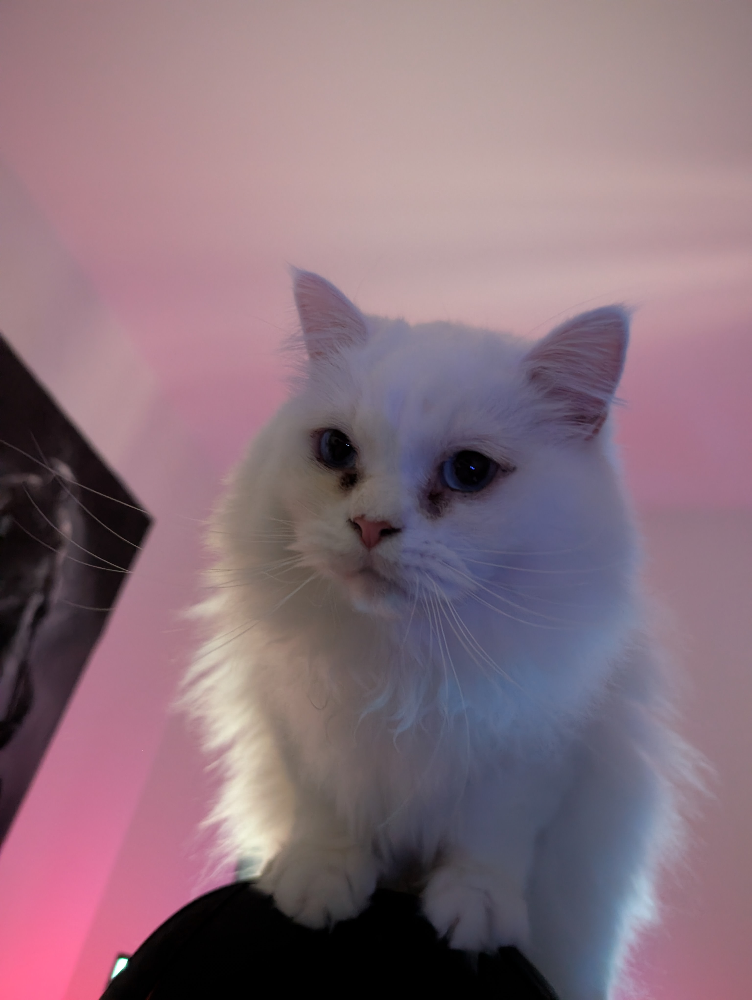

# Hi!

I'm studying Applied Computer Science (M.Sc.) at Chemnitz University of Technology, focusing on embedded systems. I'm interested in software engineering, particularly the use of Behavior Trees for autonomous UAV mission control and how to further improve their effectiveness in this context.

Alongside my studies, I work as a research assistant at the Chair of Computer Engineering. As part of the [SmartCargoDrone](https://www.tu-chemnitz.de/informatik/ce/projects/smartcargodrone.php) project, I'm developing a Mission Control System based on ROS 2 and Behavior Trees. In addition to software development, I supervise practical sessions for the Master's course Automotive Software Engineering.

I also work in industrial software development. This includes the development of software interfaces for hardware systems.

## What I work on

- **Autonomous systems:** mission execution and subsystem coordination
- **Software architecture:** modular, extensible and reusable components. I mean everyone likes a good architecture ;)
- **Embedded and industrial software:** C/C++, C#, Python and build systems
- **Formal methods:** behavioral specification, model-driven development and verification

## Projects and academic work

- **[ROS 2 Interface Spec Builder](https://github.com/jlorenz-eng/ros2-interface-spec-builder)** – A lightweight, browser-based tool for documenting ROS 2 interfaces, tracking design decisions, and exploring safety concepts. Built with AI assistance as a small side project. [Try it online](https://jlorenz-eng.github.io/ros2-interface-spec-builder/).
- **Mission Control System for Autonomous Cargo Drones** – Ongoing bachelor's thesis on the design and prototype implementation of a ROS 2-based mission control system. Code and thesis will be made available here upon completion.
- **[Quantum Key Distribution Security Standardization](https://github.com/jlorenz-eng/qkd-security-standardization)** – Comparative analysis of ISO/IEC 23837-1 and ETSI GS QKD 016 based on the Common Criteria.
- **[CLP(FD) vs. CP-SAT](https://github.com/jlorenz-eng/Vergleich-CLP-FD-und-CP-SAT)** – Systematic comparison of constraint-solving approaches with benchmarks based on N-Queens and the 7-11 problem.

## Technologies

## Beyond the Code

Haru, my supervisor 🐈

## Contact

- University email: [jonas.lorenz@s2022.tu-chemnitz.de](mailto:jonas.lorenz@s2022.tu-chemnitz.de)
- I’m based near Chemnitz in Germany
